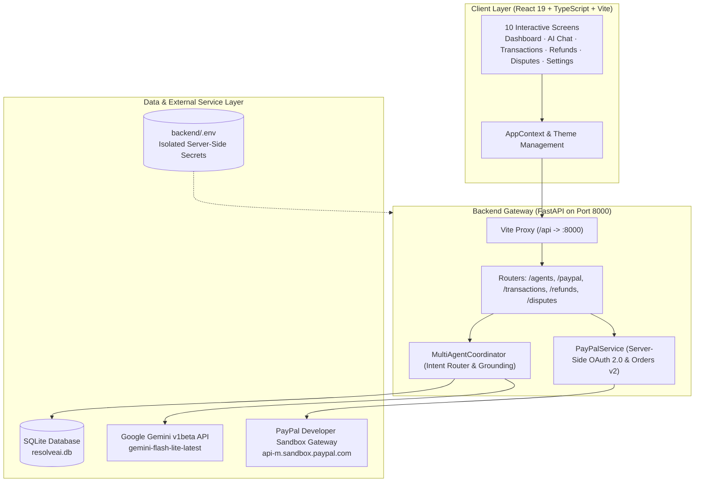

# PayPal ResolveAI 🛡️🤖

> **Autonomous AI-Powered Payment Resolution & Fraud Diagnostic Assistant**
> Built for fintech developers and hackathon demonstrations to inspect transactions, detect potential fraud risks, automate refund workflows, and assemble structured dispute dossiers with multi-agent intelligence.

[](LICENSE)
[](package.json)
[](backend/requirements.txt)
[](https://aistudio.google.com/)
[](https://developer.paypal.com/)

--

# PayPal ResolveAI
### AI-Powered Payment Resolution Assistant

🚀 **Live Website:** [Open PayPal ResolveAI](https://paypal-resolve-ai.vercel.app)

🔗 **Backend API:** [Render Backend](https://paypal-resolveai.onrender.com)

📖 **API Documentation:** [Swagger UI](https://paypal-resolveai.onrender.com/docs)

---

## 📋 Table of Contents

- [Overview & Key Features](#overview--key-features)
- [System Architecture](#system-architecture)
- [Multi-Agent AI Network](#multi-agent-ai-network)
- [PayPal Sandbox Integration](#paypal-sandbox-integration)
- [Technology Stack](#technology-stack)
- [Installation & Setup](#installation--setup)
- [Environment Configuration](#environment-configuration)
- [Running Locally](#running-locally)
- [Interactive API Documentation](#interactive-api-documentation)
- [Testing & Verification](#testing--verification)
- [Deployment Instructions](#deployment-instructions)
- [Known Limitations & Disclaimers](#known-limitations--disclaimers)
- [License](#license)

---


## 📋 Table of Contents
- [Overview & Key Features](#-overview--key-features)
- [System Architecture](#-system-architecture)
- [Multi-Agent AI Network](#-multi-agent-ai-network)
- [PayPal Sandbox Integration](#-paypal-sandbox-integration)
- [Technology Stack](#-technology-stack)
- [Installation & Setup](#-installation--setup)
- [Environment Configuration](#-environment-configuration)
- [Running Locally](#-running-locally)
- [Interactive API Documentation](#-interactive-api-documentation)
- [Testing & Verification](#-testing--verification)
- [Deployment Instructions](#-deployment-instructions)
- [Known Limitations & Disclaimers](#-known-limitations--disclaimers)
- [License](#-license)

---

## 🌟 Overview & Key Features

PayPal ResolveAI is a full-stack fintech prototype that tackles customer disputes, merchant settlement delays, and unauthorized charges using autonomous multi-agent AI and official PayPal developer APIs.

### Key Capabilities:
1. **Interactive Executive Dashboard**: 30-day transaction overview charts, risk signals, payment health score donut (92%), and live merchant breakdown.
2. **Autonomous Multi-Agent AI Assistant**: Central Coordinator delegating queries to 4 specialist agents backed by Google Gemini Flash.
3. **Transaction Forensics Hub**: Deep investigation of transaction timelines, payment gateway stages, and proof-of-delivery receipts.
4. **Fraud Guardian & Risk Engine**: Differentiates deterministic rule-based fraud scores (timestamps, duplicate amounts, merchant velocity) from LLM qualitative behavioral risk analysis.
5. **Refund Management Center**: 4-step progress tracker (*Request Submitted* → *Under Review* → *Processing* → *Refunded*) grounded in PayPal Buyer Protection 180-day policy rules.
6. **Dispute Assistant & Dossier Builder**: Compiles formal evidence packages ready for copy-paste submission to the official PayPal Resolution Center.
7. **Official PayPal Sandbox Integration**: Server-to-server OAuth 2.0 authentication, Orders v2 creation, and REST capture validation.

---

## 🏗️ System Architecture



---

## 🤖 Multi-Agent AI Network

PayPal ResolveAI features a specialized five-agent architecture orchestrated by a central coordinator:

| Agent | Icon | Domain Responsibility | Verification & Grounding |
|---|:---:|---|---|
| **AI Coordinator** | 🤖 | Query intent parsing, entity resolution, and routing to specialists. | Context-aware routing; aggregates multi-step reasoning chains. |
| **Transaction Detective** | 🔍 | Payment status forensics, merchant authorization hold diagnosis, and ACH clearing queues. | Grounded in SQLite transaction ledger (`PP-8F7K2D1`, Amazon India, $49.99). |
| **Fraud Guardian** | 🛡️ | Duplicate detection, velocity burst analysis, and security auditing. | Clearly distinguishes deterministic rules (risk score 2/10) from generative risk evaluation. |
| **Refund Assistant** | 🔄 | PayPal Buyer Protection 180-day eligibility and 4-step refund progression. | Verified against live refund records (`RF-784291`). |
| **Dispute Assistant** | ⚖️ | Evidence dossier preparation and formal PayPal Resolution Center formatting. | Incorporates 20-day negotiation rules and evidence checklists. |

---

## 💳 PayPal Sandbox Integration

The backend integrates directly with the official PayPal Developer Sandbox REST API:
- **Base Gateway**: `https://api-m.sandbox.paypal.com`
- **OAuth 2.0 Client Credentials Grant**: Basic Auth server-side handshake returning active Bearer token (`is_mock: false`).
- **Orders v2 Creation**: Generates official PayPal Orders with intent `CAPTURE`, returning genuine approval URLs (`https://www.sandbox.paypal.com/checkoutnow?token=...`).
- **Order Details Retrieval**: Real-time status inspection via `GET /v2/checkout/orders/{id}`.
- **Capture Validation**: Captures payment after buyer approval; gracefully identifies `ORDER_NOT_APPROVED` when approval is pending without falling back to mock data.
- **Security Boundary**: Client credentials are never sent to browser code or exposed in logs.

---

## 💻 Technology Stack

- **Frontend**:
  - React 19 + TypeScript
  - Vite 8 (with native reverse proxy to `/api`)
  - Tailwind CSS v4
  - Lucide React Icons
- **Backend**:
  - Python 3.13 + FastAPI
  - Uvicorn (ASGI web server)
  - SQLAlchemy ORM + SQLite
  - HTTPX (Asynchronous HTTP client for Gemini & PayPal APIs)
  - Pydantic v2 (Input schema validation)
- **Hosted AI Model**:
  - Google Gemini Flash (`gemini-flash-lite-latest` with fallback to `gemini-flash-latest`)
- **Payments Platform**:
  - PayPal Developer Sandbox (REST API v2)

---

## ⚙️ Installation & Setup

### Prerequisites
- **Node.js**: v18.0.0 or higher
- **npm**: v9.0.0 or higher
- **Python**: v3.10 or higher (v3.13 recommended)

### 1. Clone the Repository
```bash
git clone https://github.com/your-username/paypal-resolveai.git
cd paypal-resolveai
```

### 2. Install Frontend Dependencies
```bash
npm install
```

### 3. Setup Python Backend Environment
```bash
cd backend
python -m venv venv

# On Windows:
.\venv\Scripts\activate

# On macOS/Linux:
source venv/bin/activate

pip install -r requirements.txt
cd ..
```

---

## 🔐 Environment Configuration

Create a `backend/.env` file by copying the template:

```bash
cp .env.example backend/.env
```

Populate the environment variables in `backend/.env`:

```ini
# Google Gemini API Key (Get free key from https://aistudio.google.com/)
GEMINI_API_KEY=your_actual_gemini_api_key_here

# PayPal Developer Sandbox (Get credentials from https://developer.paypal.com/)
PAYPAL_CLIENT_ID=your_paypal_sandbox_client_id_here
PAYPAL_CLIENT_SECRET=your_paypal_sandbox_client_secret_here
PAYPAL_ENV=sandbox
PAYPAL_API_BASE=https://api-m.sandbox.paypal.com

# Database persistence (SQLite)
DATABASE_URL=sqlite:///./resolveai.db
```

> [!IMPORTANT]
> Never commit `backend/.env` to Git. The `.gitignore` file is configured to strictly exclude all `.env` files, local SQLite databases (`*.db`), and virtual environments (`venv/`).

---

## 🚀 Running Locally

You can run both the frontend and backend simultaneously in separate terminal sessions:

### Terminal 1: FastAPI Backend
```bash
# Windows
backend\venv\Scripts\python.exe backend\run.py

# macOS/Linux
backend/venv/bin/python backend/run.py
```
*Backend runs at:* `http://127.0.0.1:8000`

### Terminal 2: React Frontend
```bash
npm run dev
```
*Frontend runs at:* `http://localhost:5173/`

Vite automatically proxies all `/api` calls to `http://127.0.0.1:8000`.

---

## 📖 Interactive API Documentation

When the FastAPI server is running, explore the interactive OpenAPI documentation:
- **Swagger UI**: [http://127.0.0.1:8000/docs](http://127.0.0.1:8000/docs)
- **ReDoc UI**: [http://127.0.0.1:8000/redoc](http://127.0.0.1:8000/redoc)

### Primary API Endpoints:
- `GET /health` — Service healthcheck
- `POST /api/v1/agents/chat` — AI Coordinator multi-agent chat
- `GET /api/v1/paypal/status` — Live PayPal Sandbox connectivity inspection
- `POST /api/v1/paypal/orders` — PayPal Orders v2 creation
- `GET /api/v1/paypal/orders/{order_id}` — Order status inspection
- `POST /api/v1/paypal/orders/{order_id}/capture` — Authorized payment capture
- `GET /api/v1/transactions` — Transaction ledger retrieval
- `POST /api/v1/refunds` — Create refund request
- `POST /api/v1/disputes` — Assemble dispute claim

---

## 🧪 Testing & Verification

### 1. Frontend Production Build & TypeScript Check
```bash
npm run build
```
*Expected result:* 0 errors, production bundle generated in `dist/`.

### 2. Backend Health & Connectivity Check
```bash
curl http://127.0.0.1:8000/health
curl http://127.0.0.1:8000/api/v1/paypal/status
```

---

## 🚢 Deployment Instructions

### Deploying Frontend (Vercel / Netlify / Cloudflare Pages)
1. Build command: `npm run build`
2. Output directory: `dist`
3. Configure reverse proxy or rewrite rule routing `/api/*` to the deployed backend URL.

### Deploying Backend (Railway / Render / Fly.io / AWS ECS)
1. Build command: `pip install -r backend/requirements.txt`
2. Start command: `uvicorn backend.app.main:app --host 0.0.0.0 --port $PORT`
3. Set environment variables in your hosting provider's dashboard:
   - `GEMINI_API_KEY`
   - `PAYPAL_CLIENT_ID`
   - `PAYPAL_CLIENT_SECRET`
   - `PAYPAL_ENV=sandbox`

---

## ⚠️ Known Limitations & Disclaimers

1. **AI Model Testing**:
   - Google Gemini integration has been tested and verified using `gemini-flash-lite-latest` and `gemini-flash-latest`.
   - Responses are grounded in actual database context.
2. **PayPal Sandbox Testing**:
   - PayPal Developer Sandbox OAuth 2.0 authentication, Orders v2 creation, and order status retrieval have been tested and verified against official PayPal endpoints.
   - **Buyer approval and capture were not completed end-to-end** because buyer approval requires an interactive browser session with a dedicated PayPal Sandbox Personal account.
   - Unapproved capture attempts accurately return official HTTP 422 `ORDER_NOT_APPROVED` from PayPal.
3. **Demo Data**:
   - The application uses sample transaction records for demonstration and forensic illustration.
4. **No Real-Money Transactions**:
   - All payment flows are strictly restricted to the official PayPal Developer Sandbox (`https://api-m.sandbox.paypal.com`). No real-money transactions are performed.

---

## 📄 License

This project is open source and available under the [MIT License](LICENSE).
